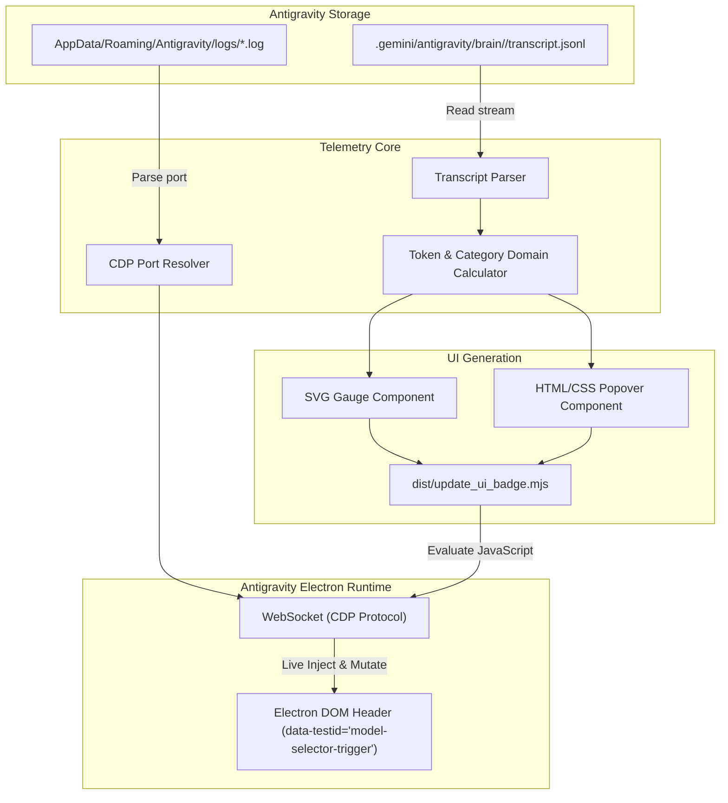

# Architectural Blueprint & Project Plan: Antigravity Context Tachometer Mod

> **Version:** 2.0.0  
> **Status:** Approved Architecture Plan  
> **Target System:** Google Antigravity 2.0 Desktop IDE  
> **Lead Architect:** Antigravity Solution Architecture Team  

---

## 1. Executive Summary & Business Discovery

### 1.1 Problem Statement
When developing with large language models in agentic coding environments like Google Antigravity 2.0, context window consumption is critical. Long multi-turn sessions, recursive subagents, tool invocations, and thinking chain-of-thought (CoT) tokens accumulate rapidly. Without real-time, non-intrusive visual feedback:
1. Developers unexpectedly reach context window compaction thresholds or token ceilings.
2. Context degradation impacts prompt adherence and agent performance without prior warning.
3. Users lack granular visibility into *what* consumes their context (raw user input vs. CoT reasoning vs. heavy tool outputs vs. MCP communication).

### 1.2 Core Objectives & Scope
- **In-Scope:**
  - Real-time telemetry extraction from active conversation transcripts located in the local Antigravity brain storage.
  - Multi-category token breakdown: User Prompts, Planner Responses, Thinking (Extended Reasoning), Local Tool calls, and MCP tool interactions.
  - Non-intrusive UI injection of an analog vector SVG tachometer gauge into the top application toolbar.
  - Interactive hover popover displaying exact token counts, percentages, and storage footprint.
  - Automated deployment and integration via Antigravity pre-invocation lifecycle hooks.
- **Out of Scope (Non-Goals):**
  - Binary patching or decompiling Electron app binaries.
  - Modifying backend LLM context compaction algorithms.
  - Cloud synchronization or external analytics transmission (100% local operation for privacy).

### 1.3 Key Actors & Use Cases
- **Developer / User:** Observes current context velocity, hovers over the speedometer to inspect token distribution, and decides when to trigger `/compact` or reset context.
- **Antigravity Hook Engine:** Triggers the metric analysis and UI update lifecycle seamlessly during workspace interactions.

---

## 2. Architecture & Design Patterns

### 2.1 Architectural Style: Clean Layered / Hexagonal Architecture
The project adheres to Clean Architecture with strict separation between Domain calculation, Application coordination, and Infrastructure integration (CDP bridge, File System):

- **Domain Layer (`src/domain/`):** Pure mathematical formulas for token approximation, category classification, angle calculation for vector needles, and threshold determination. Zero dependencies on Node.js or browser globals.
- **Application Layer (`src/application/`):** Orchestrates telemetry parsing, builds aggregate metrics snapshots, and coordinates UI component rendering contracts.
- **Infrastructure Layer (`src/infrastructure/`):**
  - **Storage Adapter:** Reads `.jsonl` transcripts from OS-specific brain directories.
  - **CDP Bridge Adapter:** Detects active Electron debug ports from roaming logs and manages the WebSocket debugging session.
  - **Bundler & Deployer:** Bundles modular sources into standalone hook-compatible ESM artifacts.

### 2.2 System Flow & Component Diagram



### 2.3 Target Project Directory Layout

```
joyful-chandrasekhar/
├── src/
│   ├── domain/
│   │   ├── entities/
│   │   │   ├── MetricSnapshot.js      # Immutable token metrics entity
│   │   │   └── GaugeState.js          # Angular rotation and color tier mapping
│   │   └── calculators/
│   │       └── tokenEstimator.js      # Deterministic token approximation rules
│   ├── application/
│   │   ├── ports/
│   │   │   ├── TranscriptRepository.js
│   │   │   └── UiBridge.js
│   │   └── use-cases/
│   │       ├── GatherTelemetry.js
│   │       └── InjectTelemetryBadge.js
│   ├── infrastructure/
│   │   ├── adapters/
│   │   │   ├── FileTranscriptRepo.js  # JSONL disk reader
│   │   │   └── CdpWebSocketBridge.js  # Chrome DevTools Protocol client
│   │   └── components/
│   │       ├── GaugeSvg.js            # Reactive SVG speedometer markup
│   │       └── PopoverHtml.js         # Telemetry breakdown overlay markup
│   └── injector.js                    # Entry point orchestrator
├── tests/
│   ├── unit/                          # Domain & mathematical calculations tests
│   └── integration/                   # CDP DOM injection & layout tests
├── dist/                              # Standalone bundled distribution files
├── build.js                           # Packager and deployment orchestrator
├── package.json
├── README.md
└── PLAN.md
```

---

## 3. Technology Stack & Decision Matrix

| Layer / Role | Selected Technology | Architectural Justification |
| :--- | :--- | :--- |
| **Runtime & Language** | **Node.js (ESM) + JavaScript** | Native runtime for Antigravity hooks and build scripts; zero transpile lag for rapid iteration. |
| **Communication Protocol** | **Chrome DevTools Protocol (CDP)** | Direct non-invasive DOM manipulation over standard Electron debugging WebSocket without binary alterations. |
| **Vector Visuals** | **Inline SVG (Scalable Vector Graphics)** | Resolution-independent, lightweight, zero-dependency rendering directly compatible with web components. |
| **Data Parsing** | **Streaming JSONL Line-Reader** | High-efficiency single-pass parsing of conversation turn logs up to tens of megabytes. |
| **Build & Deploy** | **Zero-Dependency Node Script (`build.js`)** | Clean, deterministic asset concatenation and automated delivery directly to `~/.gemini/config/mods/`. |
| **Testing Suite** | **Native Node.js Test Runner / ESM Assertions** | Zero external test dependencies, verifying CDP injection and bounding box positioning. |

---

## 4. Pure Domain Entities & Invariants

### 4.1 `MetricSnapshot`
- **Fields:**
  - `totalTokens` (Integer, non-negative): Cumulative estimated token usage.
  - `percentage` (Float, range 0.0 - 100.0): Percentage of the 1,000,000 token limit.
  - `stepCount` (Integer): Total conversational turns executed.
  - `categories` (Object): Segregated character and token counts for:
    - `user` (prompt input)
    - `model` (output completion)
    - `thinking` (internal chain-of-thought)
    - `tools` (command execution & local file I/O)
    - `mcp` (remote Model Context Protocol calls)
- **Invariants:**
  - `percentage = min(100.0, (totalTokens / 1_000_000) * 100)`.
  - The sum of category tokens must equal `totalTokens`.

### 4.2 `GaugeState`
- **Fields:**
  - `rotationAngle` (Float, range -120° to +120°): Total 240° needle arc.
  - `statusLevel` (Enum: `OPTIMAL` [0-50%], `MODERATE` [50-75%], `WARNING` [75-90%], `CRITICAL` [90-100%]).
  - `needleColor` (Hex color matching gradient range).

---

## 5. Implementation Roadmap & Milestones

### Phase 1: Pure Domain Modeling & Token Invariants
- [x] Implement robust transcript tokenizer logic for Antigravity `.jsonl` schemas.
- [x] Support distinct categorization (`USER_INPUT`, `PLANNER_RESPONSE`, `thinking`, `GENERIC`, `mcp_*`).
- [ ] Refactor pure calculation functions into isolated domain entities in `src/domain/`.
- [ ] Add unit tests verifying token estimation ratios and percentage clamping across edge cases (0 tokens, 1M+ tokens).

### Phase 2: Application Contracts & UI Component Isolation
- [x] Create standalone SVG vector speedometer gauge component (`gauge.js`).
- [x] Create styled context breakdown popover overlay (`popover.js`).
- [ ] Abstract component markup generation into decoupled presentation renderers.
- [ ] Implement responsive auto-flip for popover placement based on viewport boundaries.

### Phase 3: Infrastructure Adapters & CDP Robustness
- [x] Implement Electron log parser to dynamically resolve active CDP debugging ports.
- [x] Establish WebSocket CDP bridge to inject badge into top bar toolbar (`data-testid="model-selector-trigger"`).
- [ ] Add retry backoff and reconnection logic if Electron restarts or drops WebSocket session.
- [ ] Implement graceful fallback when CDP port is unavailable (silent background exit without throwing).

### Phase 4: Integration Testing & Verification Gates
- [x] Verify CDP DOM injection script execution via `tests/test_cdp.mjs`.
- [x] Verify hover interaction and popover coordinate positioning via `tests/test_hover.mjs`.
- [ ] Add architectural fitness checks ensuring UI code has no hardcoded absolute file system paths.

### Phase 5: Packaging, Deployment & Lifecycle Hooks
- [x] Implement build pipeline in `build.js` deploying bundle to `~/.gemini/config/mods/update_ui_badge.mjs`.
- [x] Configure Antigravity hook integration in `~/.gemini/config/hooks.json`.
- [ ] Document versioning, upgrade scripts, and uninstall workflows for cross-platform distributions.

---

## 6. Definition of Done & Governance
- [x] Architectural blueprint consolidated into a single actionable `PLAN.md`.
- [ ] Plan approved by human lead architect prior to code modifications.
- [ ] All subsequent work items driven by strict Red-Green-Refactor TDD.
