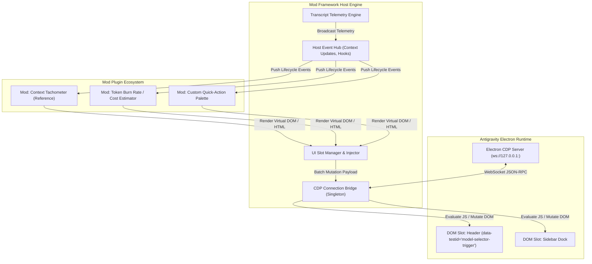

# Architectural Blueprint: Antigravity Mod Framework & Loader Engine

> **Document Type:** Master Architecture & Implementation Plan (`PLAN.md`)  
> **System:** Antigravity Mod Framework (`antigravity-mod-engine`)  
> **Version:** 3.0.0-draft  
> **Lead Architect:** Antigravity Architecture Core Team  
> **Status:** Pending Review / Human Approval  

---

## 1. Executive Summary & Vision

### 1.1 Problem Statement
Google Antigravity 2.0 provides an Electron-based desktop IDE for pair-programming and autonomous agent workflows. While highly extensible via backend skills, hooks, and MCP servers, **it lacks an official frontend extension/modding API**.

Developers wanting to augment the desktop UI (e.g. telemetry gauges, session timers, custom action buttons, prompt scratchpads, or UI themes) must resort to fragile ad-hoc scripts that tightly couple Chrome DevTools Protocol (CDP) socket connections with specific UI components. This results in:
1. Fragmented injection scripts fighting over Electron WebSocket connections.
2. Memory leaks and lingering intervals in the Electron renderer process.
3. Lack of standard UI slots, styles isolation, and plugin lifecycle management.

### 1.2 Proposed Solution: Antigravity Mod Framework
A modular, decoupled **Mod Loader and Runtime Host** that abstracts the Electron CDP layer, provides strict plugin contracts (`AntigravityMod`), and manages lifecycle states (`onInit`, `render`, `onUpdate`, `onDestroy`). The existing **Context Tachometer** becomes the flagship reference mod built on top of this standardized framework.

### 1.3 Scope & Boundaries
- **In-Scope:**
  - **Core Mod Host (`src/core/`):** Dynamic CDP port discovery, singleton WebSocket bridge, and CSS/DOM slot injection gateway.
  - **Mod Contract & SDK (`src/sdk/`):** Typed mod specification, declarative slot registry (`header-right`, `header-left`, `status-bar`, `floating-dock`), and shadow-DOM style encapsulation.
  - **Shared Host Services (`src/services/`):** Centralized telemetry engine (transcript parsing, token classification), event emitter, and lifecycle coordinator.
  - **Flagship Mod (`mods/context-tachometer/`):** The analog SVG speedometer and context breakdown popover as an isolated, pluggable mod.
  - **CLI / Hook Deployer (`src/cli/`):** Compiles and synchronizes active mods into `~/.gemini/config/mods/` with automated hook integration.
- **Out of Scope (Non-Goals):**
  - Binary patching or modifying Electron application ASAR packages.
  - Injecting untrusted remote script URLs (all mods must be local source).

---

## 2. System Architecture & Component Design

### 2.1 Hexagonal Layering & Modularity



### 2.2 Standard Mod Contract (`AntigravityMod`)

Every mod conforms to a deterministic interface:

```typescript
export interface ModManifest {
  id: string;                     // Unique identifier (e.g. 'context-tachometer')
  name: string;                   // Human-readable title
  version: string;                // SemVer format
  description: string;
  author?: string;
  slot: 'header-actions' | 'header-right' | 'status-bar' | 'floating';
  priority?: number;              // Ordering weight within the slot
}

export interface ModContext {
  telemetry: TelemetrySnapshot;   // Token count, turn steps, category breakdown
  activeConversationId: string;   // Active brain conversation GUID
  storage: ModLocalStorage;       // Sandboxed key-value state for the mod
}

export interface AntigravityMod {
  manifest: ModManifest;
  onInit?(context: ModContext): Promise<void> | void;
  render(context: ModContext): { html: string; css?: string; script?: string };
  onUpdate?(context: ModContext): void;
  onDestroy?(): void;
}
```

### 2.3 Proposed Directory Structure

```
joyful-chandrasekhar/
├── src/
│   ├── core/                          # Framework Host & CDP Engine
│   │   ├── CdpPortResolver.js         # Auto-discovers Electron debug port from logs
│   │   ├── CdpWebSocketClient.js      # Resilient WebSocket connection manager
│   │   ├── SlotManager.js             # Maps mods to target DOM selectors
│   │   └── DomSanitizer.js            # Isolates styles & prevents CSS collision
│   ├── sdk/                           # Developer SDK & Mod Contract
│   │   ├── AntigravityMod.js          # Base class / Interface specification
│   │   └── SlotRegistry.js            # Supported injection targets in Antigravity UI
│   ├── services/                      # Shared Host Capabilities
│   │   ├── TelemetryService.js        # Transcript parsing & token categorization
│   │   └── EventBus.js                # Lifecycle event pub/sub
│   └── host.js                        # Framework orchestrator entrypoint
├── mods/                              # Registered UI Mods
│   └── context-tachometer/            # Flagship Reference Mod
│       ├── manifest.json              # Mod metadata
│       ├── index.js                   # Mod lifecycle implementation
│       ├── components/
│       │   ├── GaugeSvg.js            # Analog speedometer component
│       │   └── PopoverHtml.js         # Context telemetry breakdown popover
│       └── styles.css                 # Encapsulated styling
├── tests/
│   ├── unit/                          # Port resolver, telemetry & slot tests
│   └── integration/                   # Mock CDP WebSocket injection tests
├── build.js                           # Bundles host + active mods into deployable artifact
├── package.json
├── README.md
└── PLAN.md
```

---

## 3. Technology Stack & Design Decisions

| Component / Layer | Technology Selected | Architectural Rationale |
| :--- | :--- | :--- |
| **Host Language & Runtime** | **Node.js (ESM)** | Compatible with Antigravity hook scripts, local CLI tools, and zero-compile execution. |
| **Electron UI Bridge** | **Chrome DevTools Protocol (CDP)** | Direct, non-invasive runtime inspection via standard debugging WebSocket; no code patching. |
| **Component Encapsulation** | **Scoped DOM / Shadow-DOM-like wrappers** | Prevents mod CSS from leaking into or breaking Antigravity's native Tailwind/React styles. |
| **Telemetry Parsing** | **Streaming JSONL Engine** | Ultra-fast file scanning of multi-megabyte conversation transcripts with low CPU footprint. |
| **Packaging & Bundle** | **Rollup / ESBuild (or zero-dep bundler)** | Concatenates framework runtime + mods into single-file payload for frictionless deployment. |
| **Testing** | **Node.js Native Test Runner (`node:test`)** | Zero third-party dependencies required to verify core modules and mod contracts. |

---

## 4. UI Slot Specification

The framework defines target slots mapped to Antigravity 2.0 DOM selectors:

| Slot Identifier | Antigravity DOM Anchor | Purpose |
| :--- | :--- | :--- |
| `header-actions` | `button[data-testid="model-selector-trigger"]` | Badges, tachometers, compact buttons adjacent to model selector. |
| `header-right` | Top-right toolbar container | Global indicators, clock, workspace telemetry summary. |
| `floating-dock` | `body` (fixed viewport overlay) | Diagnostics popups, floating prompts, or modal overlays. |

---

## 5. Execution Roadmap & Milestones

### Phase 1: Core Host Architecture & CDP Decoupling
- [x] Refactor existing `injector.js` into modular `CdpPortResolver.js` and `CdpWebSocketClient.js`.
- [x] Implement `SlotManager.js` to coordinate DOM element anchors dynamically.
- [x] Add unit tests verifying port parsing from Antigravity logs across multiple session formats.

### Phase 2: Mod SDK & Standard Lifecycle Contract
- [ ] Define the `AntigravityMod` base interface and lifecycle events (`onInit`, `render`, `onUpdate`, `onDestroy`).
- [ ] Implement runtime CSS prefixing / style isolation for injected mods.
- [ ] Create a Mod Loader (`ModLoader.js`) that automatically discovers and registers mods from `mods/*/`.

### Phase 3: Port Context Tachometer as First-Party Mod
- [ ] Migrate `src/metrics.js` to `src/services/TelemetryService.js`.
- [ ] Migrate `gauge.js` and `popover.js` into `mods/context-tachometer/`.
- [ ] Implement `mods/context-tachometer/index.js` matching the new `AntigravityMod` contract.

### Phase 4: Build System & Multi-Mod Bundling
- [ ] Update `build.js` to bundle the Core Host together with all enabled mods into `dist/antigravity_mod_loader.mjs`.
- [ ] Deploy the bundle to `~/.gemini/config/mods/` and configure `~/.gemini/config/hooks.json`.
- [ ] Verify simultaneous mounting and unmounting of multiple mock mods.

### Phase 5: Developer Ergonomics & Documentation
- [ ] Provide a boilerplate template for creating new mods in 5 minutes (`mods/template/`).
- [ ] Document the Mod SDK API in `docs/MOD_AUTHORING_GUIDE.md`.
- [ ] Release automated smoke test script (`tests/verify_loader.mjs`).

---

## 6. Definition of Done & Architectural Invariants
1. **Host Stability:** Mod failure or uncaught exceptions inside a mod MUST NOT crash Antigravity or hang the CDP connection.
2. **Zero Global Pollution:** Mods cannot pollute the global `window` namespace except through a single namespaced registry (`window.__antigravityMods`).
3. **Strict Gate:** No code execution or refactoring begins until the architecture blueprint is validated.
