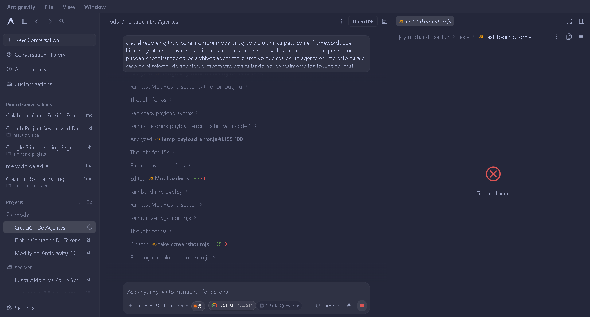
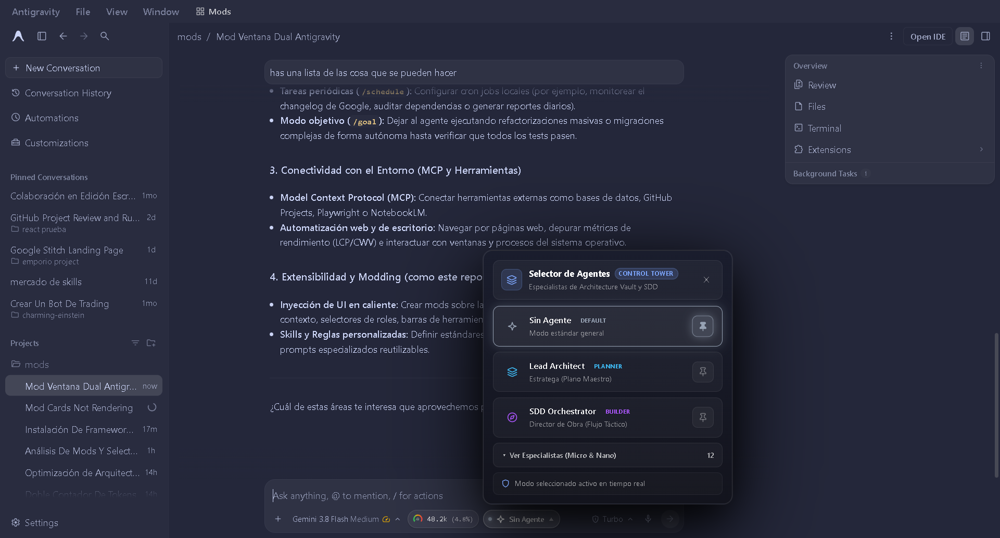
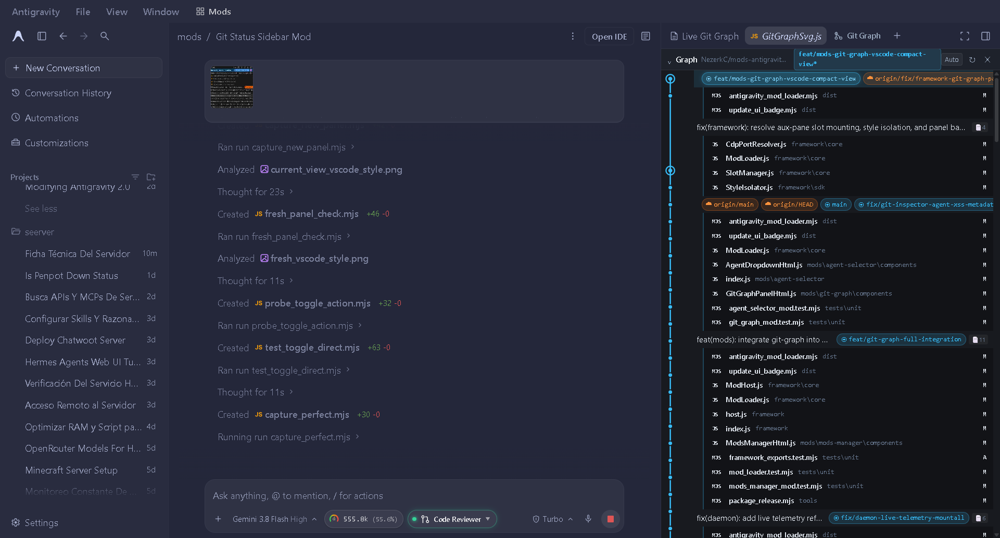
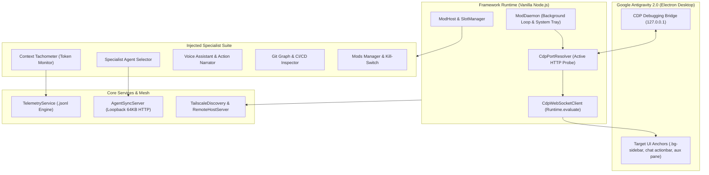

# Mods Antigravity 2.0 (`mods-antigravity2.0`)

[](LICENSE)
[](tests/)
[](package.json)
[](package.json)
[](https://antigravity.google)

> Extensible, zero-dependency UI mod framework and specialist suite for the Google Antigravity 2.0 Desktop Application.

`mods-antigravity2.0` injects isolated reactive UI panels, accurate per-conversation token telemetry, dynamic specialist role switching, audio action narration, and distributed peer synchronization into Google Antigravity via the Chrome DevTools Protocol (CDP) — without modifying Electron application binaries or compromising host sandbox boundaries.

---

## Visual Preview



<p align="center">
  
  
</p>

---

## Architectural Highlights



---

## Key Features

### 1. Accurate Per-Chat Context Tachometer
- Reads `.system_generated/logs/transcript_full.jsonl` matching active conversation IDs (`data-cascade-id` and `/c/<id>`) in real time.
- Handles dual-limit quota models (Gemini / Claude) and Argon single-tier limits with reset countdowns.
- Accurately tracks compaction checkpoints, displaying active context window usage alongside cumulative billing quota.
- 240° SVG gradient speedometer with click-to-toggle popover portal and auto-flip positioning.

### 2. Dynamic Agent Discovery & Specialist Selector
- Automatically scans and indexes specialist roles from workspace manifests (`./agents/*.md`, `**/*.agent.md`, `agent.md`), the Shared Architecture Vault, and Global Skills.
- Parses YAML frontmatter and Markdown headers to infer roles, competencies, and suites.
- Hierarchical classification across Cúspide (Planner/Builder), Micro, and Nano tiers with search filtering and direct badge synchronization.

### 3. Voice Assistant & Real-Time Action Narrator
- Non-invasive Web Speech Synthesis (TTS) module providing immediate auditory feedback during autonomous workflows.
- Translates background agent thoughts, file operations, bash executions, and subagent dispatches into natural spoken narratives.
- Sanitizes streaming payloads, stripping markdown formatting, code fences, and raw URLs before synthesis.

### 4. Git Graph & CI/CD Inspector
- Mounts directly into Antigravity's auxiliary workspace pane.
- Renders an interactive SVG commit DAG with branch filtering, commit inspector cards, and direct GitHub links.
- Real-time pull request status cards with live CI/CD test check badges and error summaries.

### 5. Tailscale Remote Mesh & Peer Sync
- Built-in `RemoteHostServer` providing Server-Sent Events (SSE) telemetry streaming across secure private networks.
- Automatic node discovery via `TailscaleDiscoveryService`, separating local and remote online peers for cross-device chat telemetry.

### 6. Central Mods Manager & Stealth Kill-Switch
- Sidebar header button (`.bg-sidebar`) opening a slide-out drawer with per-mod activation toggles.
- Instantaneous kill-switch (`localStorage.__antigravity_daemon_enabled`) allowing complete client-side detachment without app restarts.

### 7. Background Daemon & Windows System Tray
- Multi-port discovery engine automatically locating Antigravity's active CDP port (`127.0.0.1:53908`, `9222`, etc.) via active HTTP probing.
- Self-healing reinjection on window navigation, reload, or app restart without DOM thrashing.
- Interactive launcher (`start-daemon.bat`) with persistent PowerShell tray icon and one-click auto-start registration (`shell:startup`).

---

## Engineering Standards

- **Zero Runtime Dependencies**: The core framework, WebSocket client, and services are implemented with 100% native Node.js APIs (`http`, `fs`, `path`, `events`, `child_process`) and standard browser DOM interfaces.
- **Enterprise Test Coverage**: **139 automated tests** covering unit behavior, protocol adapters, DOM mutations, and end-to-end remote mesh streams.
- **Strict Security & Sandboxing**: All dynamic markup undergoes strict XSS output encoding. Socket bindings are restricted to loopback interfaces with strict payload constraints (see [SECURITY.md](SECURITY.md)).
- **Clean Architecture**: Complete separation of concerns between runtime services (`framework/services/`), core injection lifecycle (`framework/core/`), and UI mods (`mods/`).

---

## Installation & Setup

### Prerequisites
- **Node.js**: v18.0.0 or higher.
- **Google Antigravity 2.0**: Desktop application running locally.

### Step 1: Build Bundles
Compile all modules and deploy the unified loader into Antigravity's config path:

```bash
npm run build
```

### Step 2: Launch Daemon

#### Option A: Windows System Tray Launcher (Recommended)
Launch the interactive manager:

```bat
.\start-daemon.bat
```

Select from the interactive menu:
- `[1] Iniciar en segundo plano`: Runs the daemon with a Windows System Tray icon.
- `[2] Ver estado del daemon`: Reports PID, tray process, and startup status.
- `[3] Detener daemon`: Terminates running background daemons cleanly.
- `[4] Instalar en el inicio de Windows`: Registers the daemon in Windows Startup (`shell:startup`).
- `[5] Desinstalar del inicio de Windows`: Unregisters auto-start persistence.

#### Option B: NPM CLI Scripts
```bash
# Start background daemon
npm run daemon:start

# Inspect status
npm run daemon:status

# Stop daemon
npm run daemon:stop
```

---

## Verification & Diagnostics

```bash
# Run complete test suite (139 passing tests)
npm test

# Probe active CDP debugging endpoint
npm run probe:cdp

# Inspect DOM structure of running Antigravity 2.0
npm run probe:dom

# Track Antigravity and Node processes
npm run probe:proc
```

---

## Project Structure

```text
mods-antigravity2.0/
├── framework/                       # Core Mod Framework & Runtime
│   ├── core/                        # CDP client, port resolver, mod host & loader
│   ├── sdk/                         # AntigravityMod base class & StyleIsolator
│   ├── services/                    # Telemetry, AgentDiscovery, GitService, Tailscale
│   └── index.js                     # Unified framework entrypoint
├── mods/                            # User-Facing Injected Mods
│   ├── agent-selector/              # Specialist catalog & in-chat role injector
│   ├── context-tachometer/          # Per-chat token speedometer & popover
│   ├── git-graph/                   # Auxiliary pane commit DAG & CI/CD inspector
│   ├── mods-manager/                # Sidebar trigger & kill-switch manager
│   └── voice-assistant/             # Real-time TTS & action narrator
├── dist/                            # Production bundled distributions
├── docs/                            # Architecture specs, guides & visual assets
├── tests/                           # Unit & functional test suite (139 tests)
├── tools/                           # Diagnostic CLI utilities & packaging scripts
├── build.js                         # Production bundler
├── CONTRIBUTING.md                  # Development principles & workflow
├── LICENSE                          # MIT License
├── package.json                     # Package metadata & npm scripts
├── README.md                        # Documentation & visual overview
├── SECURITY.md                      # Security policy & threat model
└── start-daemon.bat                 # Windows Tray & background service manager
```

---

## Governance & Contributing

We welcome contributions! Please review our [Contributing Guidelines](CONTRIBUTING.md) and [Security Policy](SECURITY.md) before submitting Pull Requests.

---

## Author

**Victor Manuel Martinez Munoz** (`@NezerkC`)  
Software Technician & Software Engineering Student — DUOC UC, Alameda Campus  
Santiago, Chile

---

## License

This project is licensed under the [MIT License](LICENSE).
