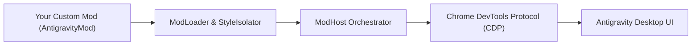

# Antigravity Mod Authoring Guide

Welcome to the **Google Antigravity 2.0 Mod Framework**. This guide explains how to design, develop, test, and package custom desktop UI mods.

---

## 1. Overview & Architecture

The Antigravity Mod Framework is a non-invasive plugin system that allows developers to extend the Antigravity desktop IDE interface:



### Core Architectural Guarantees:
1. **Zero Binary Patching:** Integrates directly via standard Chrome DevTools Protocol (CDP) WebSockets discovered at runtime.
2. **Style Isolation:** Mod CSS is automatically scoped under unique container namespaces (`#antigravity-mod-<id>`) to prevent collisions with Antigravity's host UI.
3. **Lifecycle Management:** Clean mounting, updating, and unmounting contracts with zero memory leaks.

---

## 2. Anatomy of a Mod

Every mod resides in `mods/<your-mod-name>/` and consists of:

```
mods/my-custom-mod/
├── manifest.json      # Metadata & slot configuration
├── styles.css         # Scoped styles
└── index.js           # Class implementing AntigravityMod
```

### 2.1 The Manifest (`manifest.json`)

```json
{
  "id": "my-quick-actions",
  "name": "Quick Actions Palette",
  "version": "1.0.0",
  "description": "Shortcuts to compact context and trigger unit tests",
  "slot": "header-actions",
  "priority": 20
}
```

- **`id`** *(string, required)*: Unique slug identifier.
- **`name`** *(string, required)*: Human-readable display name.
- **`version`** *(string, required)*: Semantic versioning string.
- **`slot`** *(string, required)*: Target DOM slot anchor.
- **`priority`** *(number, optional)*: Ordering weight (higher loads first; default `10`).

---

## 3. Supported UI Slots

| Slot Name | Target Anchor in Antigravity | Common Uses |
| :--- | :--- | :--- |
| `header-actions` | Adjacent to model selector trigger (`button[data-testid="model-selector-trigger"]`) | Telemetry gauges, quick action buttons, status pills. |
| `header-right` | Top application header trailing corner | Workspace clock, session duration, profile badges. |
| `status-bar` | Bottom footer / status area | Git branch indicators, linter status, memory usage. |
| `floating-dock` | Fixed viewport overlay (`body`) | Floating notification cards, scratchpads, overlay panels. |

---

## 4. The `AntigravityMod` Lifecycle

Subclass `AntigravityMod` from `framework/sdk/AntigravityMod.js`:

```javascript
import { AntigravityMod } from '../../framework/sdk/AntigravityMod.js';

export class MyQuickActionsMod extends AntigravityMod {
  constructor() {
    super({
      id: 'my-quick-actions',
      name: 'Quick Actions Palette',
      version: '1.0.0',
      slot: 'header-actions',
      priority: 20
    });
  }

  // 1. Called once when host registers the mod
  async onInit(context) {
    console.log('Mod initialized with context:', context);
  }

  // 2. Main render method (MUST return { html, css? })
  render(context) {
    const tokens = context.telemetry?.displayTokens || '0';
    return {
      html: `
        <button class="action-btn" onclick="alert('Current context: ${tokens}')">
          ⚡ Action
        </button>
      `.trim(),
      css: `
        .action-btn {
          background: rgba(255, 255, 255, 0.08);
          border: 1px solid rgba(255, 255, 255, 0.15);
          border-radius: 9999px;
          color: #fff;
          font-size: 11px;
          padding: 3px 8px;
          cursor: pointer;
        }
        .action-btn:hover {
          background: rgba(255, 255, 255, 0.16);
        }
      `
    };
  }

  // 3. Called on turn telemetry updates without full remount
  onUpdate(context) {}

  // 4. Called when mod is unmounted
  onDestroy() {}
}
```

---

## 5. Telemetry & Host Context

The `context` object passed to `render(context)` provides:

```typescript
interface ModHostContext {
  telemetry: {
    estTokens: number;        // e.g. 42100
    pct: string;              // e.g. "4.2"
    displayTokens: string;    // e.g. "42.1k"
    sizeKb: number;           // e.g. 150
    steps: number;            // e.g. 78
    breakdown: {
      user: { tokens: number, pct: number };
      model: { tokens: number, pct: number };
      thinking: { tokens: number, pct: number };
      tools: { tokens: number, pct: number };
      mcp: { tokens: number, pct: number };
    }
  };
  activeConversationId?: string;
  timestamp: number;
}
```

---

## 6. How to Build & Deploy

To bundle and deploy active mods to your local Antigravity installation:

```bash
# Run unit tests
npm test

# Build and deploy into ~/.gemini/config/mods/
npm run build
```

The deploy script automatically updates `~/.gemini/config/mods/antigravity_mod_loader.mjs`, which is executed dynamically on turn pre-invocation hooks.
