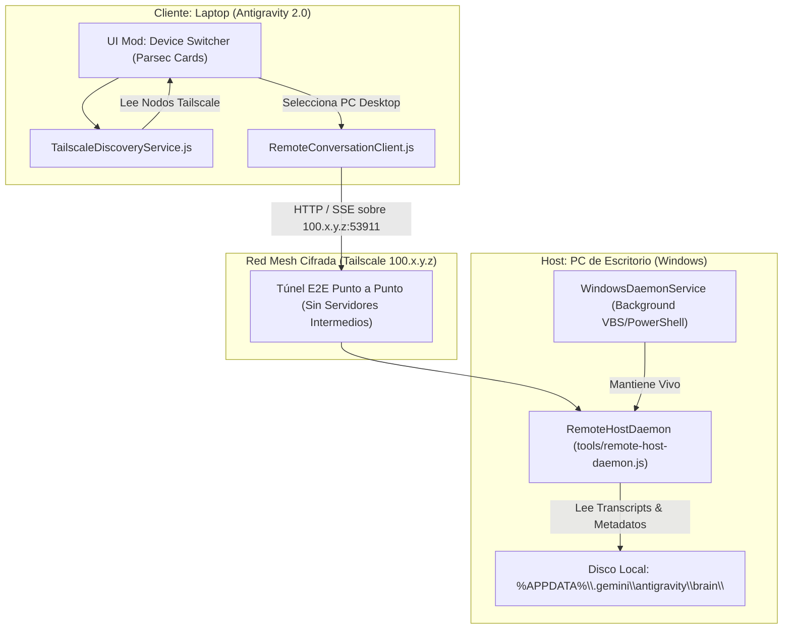

# Architectural Blueprint: Antigravity Remote Mesh (Parsec-Style over Tailscale)

> **Document Type:** Master Feature Architecture & Implementation Plan (`PLAN_TAILSCALE_REMOTE_MESH.md`)  
> **System:** Antigravity 2.0 Mod Framework (`mods-antigravity2.0`)  
> **Lead Architect:** Lead Software Architect & Multi-Agent Orchestrator  
> **Status:** Pending Review / Human Approval  
> **Target Devices:** PC Desktop (Host) <-> Laptop (Client)  
> **Network Transport:** Tailscale WireGuard Mesh (100.x.y.z)

---

## 1. Visión y Descubrimiento del Negocio (Product Discovery)

### 1.1 Problema a Resolver
El usuario necesita acceder a los proyectos, conversaciones activas y agentes que corren en su PC de escritorio principal desde su laptop (en movilidad o en otras habitaciones) sin recurrir a streaming de video pesado (como Chrome Remote Desktop o VNC), que consume alto ancho de banda, drena batería y carece de integración nativa con la interfaz de Antigravity 2.0.

### 1.2 Solución Propuesta: Antigravity Remote Mesh
Un subsistema desacoplado que replica la experiencia de **Parsec para Inteligencia Artificial**:
1. **Detección Automática de Dispositivos:** Mediante `TailscaleDiscoveryService.js`, el cliente en la laptop detecta los nodos en la red Tailscale (`laptop`, `pc Desktop`) con su estado en vivo (`Online` / `Offline`) y su IP virtual `100.x.y.z`.
2. **Host Daemon Desacoplado en PC (Opción 2):** Un servicio de fondo independiente en Node.js que se ejecuta en el PC de escritorio, escuchando estrictamente en su IP de Tailscale y exponiendo los `transcript.jsonl` y metadatos de las conversaciones de `%APPDATA%\.gemini\antigravity\brain\`.
3. **UI Mod (Selector de Dispositivos):** Un componente visual inyectado en el header/sidebar de Antigravity 2.0 que renderiza las tarjetas de los equipos y permite alternar entre `This Computer (Local)` y `PC Desktop (Remoto)`.

### 1.3 Alcance y Límites (In-Scope vs Non-Goals)
- **En Scope:**
  - Descubrimiento local de peers de Tailscale vía CLI (`tailscale status --json`).
  - Daemon independiente de Windows (`tools/remote-host-daemon.js`) con arranque en segundo plano (`WindowsDaemonService`).
  - Contratos de API REST/SSE protegidos por binding exclusivo en interfaz `100.x.y.z`.
  - Cliente de consumo remoto (`RemoteConversationClient.js`) con streaming de transcripts.
  - Mod visual con tarjetas de dispositivos estilo Parsec.
- **Fuera de Alcance (Non-Goals):**
  - Streaming de pantalla completa o video píxel a píxel.
  - Exposición de puertos en routers WAN (sin port-forwarding; 100% aislado en la tailnet).
  - Modificación de binarios o parcheo del ASAR de Antigravity.

---

## 2. Arquitectura de la Solución (Hexagonal & DAG)



---

## 3. Contratos de Frontera y Esquemas (CDD)

El daemon del PC de escritorio expone una API mínima en el puerto `53911`, escuchando exclusivamente en la dirección IP de Tailscale (`100.66.147.17`).

### 3.1 `GET /api/v1/health`
Verifica conectividad y telemetría básica del host.
```json
{
  "status": "ok",
  "nodeName": "builchina",
  "tailscaleIp": "100.66.147.17",
  "uptimeSeconds": 1420,
  "activeConversationsCount": 12
}
```

### 3.2 `GET /api/v1/conversations`
Lista las conversaciones activas ordenadas por última actualización.
```json
[
  {
    "id": "bb7529f3-9338-4580-9763-2adcd6cc445f",
    "title": "Accessing Conversations Across Computers",
    "updatedAt": "2026-10-28T23:55:00Z",
    "tokenUsage": 74500,
    "model": "gemini-3.8-flash",
    "hasArtifacts": true
  }
]
```

### 3.3 `GET /api/v1/conversations/:id/stream`
Stream Server-Sent Events (SSE) que envía las líneas de `transcript.jsonl` conforme el agente escribe en la torre.

---

## 4. Políticas de Seguridad y Resiliencia (Zero Trust)

1. **Binding Exclusivo:** El servidor HTTP del host se enlaza a `100.66.147.17` (la IP de Tailscale del host) y nunca a `0.0.0.0`. Ningún dispositivo fuera de la tailnet autorizada por la cuenta Google puede alcanzar el puerto.
2. **Fail-Safe & Circuit Breaker:** Si la torre entra en reposo o se interrumpe la red, el cliente en la laptop marca el nodo como `Offline (Reconectando...)` sin congelar la UI de Antigravity.
3. **Keep-Alive:** Integración con `WindowsDaemonService` para supervisión del proceso de fondo en el PC.

---

## 5. Roadmap de Implementación (Hitos TDD)

### Hito 1: Descubrimiento de Nodos (Completado)
- [x] Crear `TailscaleDiscoveryService.js` en `framework/services/`.
- [x] Soporte para `checkStatus()`, `getDevices()`, `getOnlinePeers()`, `findDeviceByName()`.
- [x] Cobertura unitaria en `tests/unit/TailscaleDiscoveryService.test.mjs` (116 tests pasando).
- [x] Commit convencional en rama `feat/framework-tailscale-device-discovery`.

### Hito 2: Remote Host Daemon (PC Escritorio)
- [ ] Implementar `tools/remote-host-daemon.js`:
  - Enlace estricto a la IP de Tailscale.
  - Endpoint `/api/v1/health`.
  - Endpoint `/api/v1/conversations` leyendo `transcript.jsonl` de carpetas locales.
  - Streaming SSE para `transcript.jsonl`.
- [ ] Tests unitarios y de integración para el daemon.

### Hito 3: Autoinstalador de Servicio de Fondo (WindowsDaemonService)
- [ ] Crear comando/script para registrar el daemon como servicio de fondo persistente en Windows (inicio con el sistema).
- [ ] Script de verificación de salud y parada limpia.

### Hito 4: Cliente Remoto en Framework (`RemoteConversationClient.js`)
- [ ] Implementar cliente HTTP/SSE en `framework/services/RemoteConversationClient.js`.
- [ ] Conectar con `TailscaleDiscoveryService` para seleccionar la IP del peer activo.
- [ ] Tests unitarios con mocks.

### Hito 5: UI Mod (`mods/device-selector/`)
- [ ] Diseñar las tarjetas estilo Parsec (`laptop` y `pc Desktop`) con semáforo verde/gris e IP.
- [ ] Montar el mod en el slot `header-actions` o `sidebar-dock` usando `SlotManager`.
- [ ] Interacción de clic: al pulsar `pc Desktop`, conmuta el contexto para mostrar las conversaciones remotas.
