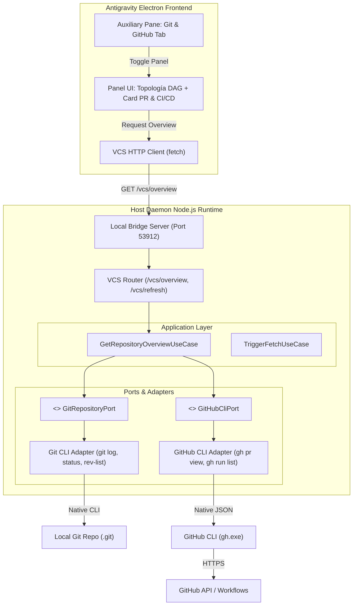

# Plan de Arquitectura: Git & GitHub VCS Suite con CI/CD

> **Fecha:** 2026-10-25  
> **Estado:** Propuesta de Planificación Arquitectónica  
> **Autor:** Lead Solution Architect & Product Planner  
> **Documento:** `docs/PLAN_VCS_CICD.md`  

---

## 1. Visión y Descubrimiento del Negocio

### 1.1 Problema a Resolver
En el entorno de desarrollo con agentes de Antigravity 2.0, el desarrollador necesita visibilidad inmediata y simultánea del **estado local de Git** (commits, ramas activas, archivos modificados, commits ahead/behind) y del **estado remoto de GitHub** (Pull Request vinculado, revisores, checks de CI/CD de GitHub Actions o Jenkins). Actualmente:
1. El mod visualizador existente (`mods/git-graph`) depende de datos estáticos o llamadas a `child_process` inaccesibles desde el Renderer de Electron.
2. No existe paridad entre el control de versiones local (`git`) y el orquestador remoto (`gh`).
3. Falta una interfaz unificada donde el desarrollador y los agentes autónomos puedan auditar si las pruebas y linters pasaron antes de fusionar ramas.

### 1.2 Objetivos y Alcance
- **En Scope (Git y GitHub a la par):**
  - **Git Local Core:**
    - Visualización topológica (DAG) de commits, ramas locales y remotas (`origin/*`), tags y HEAD activo.
    - Detección reactiva de estado del working tree: archivos modificados, agregados, eliminados y conteo de `ahead / behind`.
    - Inspector de commits con desglose de archivos modificados y cálculo de autor/avatar.
  - **GitHub & CI/CD Remoto:**
    - Detección automática del Pull Request asociado a la rama actual (título, número, autor, estado `OPEN`/`MERGED`/`CLOSED`).
    - Consolidación y visualización del estado de CI/CD (`statusCheckRollup`) para la rama o PR (exitoso, en progreso, fallido) con enlaces a los jobs de GitHub Actions y checks externos (Jenkins/Sonar/etc.).
  - **Arquitectura BFF (Backend-for-Frontend):**
    - Servicio desacoplado en el Daemon (Node.js) que interactúa con `git` y `gh` en formato JSON nativo y expone endpoints HTTP locales seguros (`127.0.0.1:53912`).
    - Cliente reactivo en el Mod UI (`aux-pane-tab`) con botón de recarga bajo demanda y auto-refresh sin bloqueo del hilo principal.

- **Fuera de Alcance (Non-Goals para v1):**
  - Editor interactivo de conflictos de merge con GUI tridimensional (se mantiene la resolución en editor de texto estándar).
  - Creación interactiva de Pull Requests con formulario enriquecido (el flujo se enfoca en visualización e inspección del estado activo).
  - Integración directa con APIs propietarias de Jenkins sin pasar por el commit status de GitHub.

### 1.3 Actores y Casos de Uso Principales
- **Desarrollador (Victor):**
  - Consulta en el panel auxiliar el gráfico de ramas locales y remotas.
  - Verifica si los checks de CI/CD de su PR están verdes antes de pedir revisión o hacer merge.
  - Hace clic en un commit para inspeccionar qué archivos cambiaron y quién fue el autor.
- **Agentes Autónomos de Antigravity:**
  - Consultan el endpoint local del Daemon para saber si el commit recién generado tiene tests de CI pasando o requiere fixes.

---

## 2. Arquitectura del Sistema

### 2.1 Estilo y Principios
- **Patrón:** Hexagonal (Ports & Adapters) en el Daemon con capa de presentación desacoplada (BFF + Injected Mod).
- **Separación de Responsabilidades:**
  - El **Renderer de Electron** solo renderiza HTML/SVG y realiza peticiones `fetch()` HTTP locales.
  - El **Daemon de Node.js** asume la ejecución de procesos del sistema operativo (`git`, `gh`) y el cacheo de respuestas.
- **Resiliencia:** Si `gh` no está autenticado o no hay conexión a internet, el sistema degrada elegantemente mostrando la topología local de `git` sin bloquear la UI.

### 2.2 Diagrama de Flujo y Componentes


### 2.3 Estructura de Directorios Propuesta
```
framework/
├── services/
│   ├── GitService.js          # Adaptador de bajo nivel para Git CLI
│   ├── GitHubCliService.js     # Adaptador de bajo nivel para gh CLI (JSON nativo)
│   ├── VcsOrchestrator.js      # Caso de uso unificado (Git Local + GitHub CI/CD)
│   └── AgentSyncServer.js     # Servidor HTTP extendido con rutas /vcs/*
mods/
└── git-graph/
    ├── components/
    │   ├── GitGraphPanelHtml.js # Estructura HTML con card de PR y CI/CD
    │   ├── GitGraphSvg.js       # Renderizado del grafo SVG de ramas
    │   ├── PrCiCardHtml.js      # Componente visual para PR y checks de CI/CD
    │   └── CommitInspectorHtml.js # Inspector de detalles de commit y archivos
    ├── styles.css               # Estilos aislados con tokens temáticos
    └── index.js                 # Entrypoint del Mod
tests/
├── unit/
│   ├── git_service.test.mjs
│   ├── github_cli_service.test.mjs
│   └── vcs_orchestrator.test.mjs
```

---

## 3. Matriz de Stack Tecnológico

| Capa / Rol | Tecnología Elegida | Justificación Técnica |
| :--- | :--- | :--- |
| **Backend / Daemon** | Node.js (ES Modules) | Runtime ya integrado en el framework de mods sin dependencias externas pesadas |
| **Integración Git** | `git` CLI (vía `child_process.execFile`) | Estándar universal, máxima velocidad de lectura de refs, logs y porcelain |
| **Integración GitHub** | `gh` CLI (JSON flags `--json`) | Evita manejo de tokens OAuth manuales; reutiliza la sesión activa del usuario |
| **Comunicación BFF** | Servidor HTTP nativo `node:http` | Cero librerías adicionales, latencia < 2ms en localhost (`127.0.0.1:53912`) |
| **Interfaz UI** | Vanilla JS Scoped + SVG | Compatible con el Slot Manager e inyección dinámica en Antigravity 2.0 |
| **Testing** | Node.js Test Runner (`node:test`) | Suite nativa rápida y determinista (garantía de 0 broken commits) |

---

## 4. Entidades de Dominio e Invariantes

### 4.1 Entidades Principales
1. **`GitCommit`:**
   - Hash completo (SHA-1/256), shortHash, autor (nombre, email, avatar), timestamp, subject, padres (`parents[]`), refs (`refs[]`), lane (carril asignado) y lista de archivos modificados (`files[]`).
2. **`BranchTopology`:**
   - Carriles paralelos asignados deterministamente y rutas Bezier (`routes[]`) para forks y merges.
3. **`PullRequestOverview`:**
   - Número de PR, título, rama origen (`headRef`), rama destino (`baseRef`), estado (`OPEN`, `MERGED`, `CLOSED`), URL web y autor.
4. **`CiCheckRollup`:**
   - Lista de checks (`name`, `workflowName`, `status`, `conclusion`, `detailsUrl`, `duration`), resumen global (`SUCCESS`, `PENDING`, `FAILURE`) y porcentaje de aprobación.
5. **`RepositoryStatus`:**
   - Rama actual, indicador de limpieza (`isClean`), contador `ahead` y `behind` respecto al upstream.

### 4.2 Invariantes de Negocio
- **Degradación no destructiva:** Si no hay repositorio Git activo, el servicio responde `isRepo: false` sin lanzar excepciones no controladas.
- **Aislamiento de red:** La falla de conectividad con GitHub o falta de autenticación en `gh` nunca debe impedir ver el historial local de commits.
- **Sanitización estricta:** Todos los títulos de PR, nombres de ramas, mensajes de commit y nombres de checks deben sanitizarse contra XSS antes de inyectarse en el DOM.

---

## 5. Roadmap de Ejecución (Épicas y Tareas)

### Fase 1: Servicios de Dominio e Integración CLI (TDD)
- [ ] Implementar `GitHubCliService.js` con soporte para:
  - Detección de instalación y autenticación (`gh auth status`).
  - Obtención de PR activo de la rama actual (`gh pr list/view --json`).
  - Obtención de runs de CI/CD (`gh run list`).
- [ ] Crear tests unitarios en `tests/unit/github_cli_service.test.mjs`.
- [ ] Extender `GitService.js` para soportar diff de líneas (`+ / -`) por archivo modificado.

### Fase 2: Orquestador VCS y Exposición HTTP en el Daemon
- [ ] Crear `VcsOrchestrator.js` unificando `GitService` + `GitHubCliService` en un único payload consolidado.
- [ ] Extender `AgentSyncServer.js` con las rutas:
  - `GET /vcs/overview` (retorna rama, status, commits, PR activo y rollup de CI/CD).
  - `POST /vcs/fetch` (ejecuta `git fetch` en segundo plano para actualizar remotos).
- [ ] Tests de integración para los endpoints HTTP del servidor.

### Fase 3: Componente Visual de Pull Request & CI/CD
- [ ] Diseñar el componente `PrCiCardHtml.js`:
  - Cabecera con número de PR, ramas y pill de estado (`Open`/`Merged`).
  - Badge global de CI/CD (verde/amarillo/rojo) con contador de checks pasados.
  - Acordeón expandible para ver cada check individual con su enlace directo.
- [ ] Diseñar el componente `CommitInspectorHtml.js` para visualización detallada del commit seleccionado.

### Fase 4: Integración en el Mod de Antigravity (`GitGraphMod`)
- [ ] Conectar los listeners del botón de refresco `↻` y cierre `✕`.
- [ ] Implementar el cliente `fetch` en el mod para polling inteligente o actualización bajo demanda.
- [ ] Ajustar la hoja de estilos `styles.css` con diseño compacto alineado con la estética de Antigravity / VS Code.

### Fase 5: Compilación, Pruebas End-to-End y Gobernanza
- [ ] Actualizar `build.js` para empaquetar los nuevos componentes en `dist/antigravity_mod_loader.mjs`.
- [ ] Ejecutar suite completa de tests (`npm test`) asegurando 100% de tests pasando.
- [ ] Desplegar en `~/.gemini/config/mods/` y verificar en vivo sobre la ventana de Antigravity 2.0.

---

## 6. Criterios de Aceptación y Próximos Pasos
- [ ] El archivo de arquitectura es revisado y aprobado por el usuario.
- [ ] Cero líneas de código productivo emitidas antes de la validación del plan.
- [ ] Inicio de la Fase 1 bajo la política de commits atómicos en rama dedicada (`feat/vcs-git-github-cicd-suite`).
